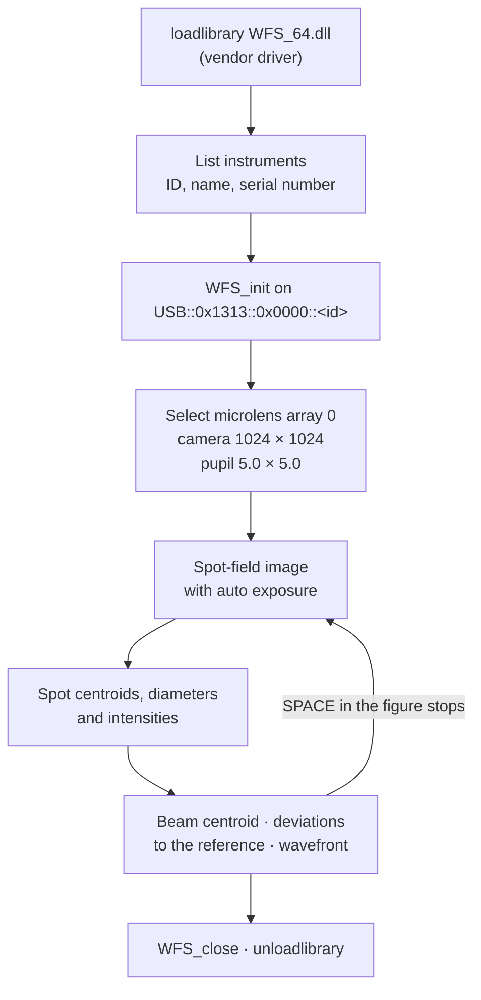

<div align="center">

# Shack–Hartmann Sensor Integration

**MATLAB scripts (2022) that drive a USB Shack–Hartmann wavefront sensor through its vendor WFS driver: live spot-field images, spot centroids, deviations and the wavefront.**

[](https://www.mathworks.com/products/matlab.html)
[](#-requirements)
[](https://github.com/mavasbel-research/shack-hartmaan_sensor_integration/commits/main)
[](#-known-issues)

</div>

> [!NOTE]
> Lab integration scripts written in February–March 2022. They need the sensor hardware and its vendor driver, and are kept as a reference.

## 🔭 What `basic_reading.m` does



The live figure shows the spot-field image. The centroids, deviations and wavefront are computed each iteration but are not plotted or saved.

## 🗂️ Files

| File | Purpose |
|:---|:---|
| `basic_reading.m` | Sensor read-out loop shown above |
| `daq_simple_test.m` | Voltage test of a multiplexer on `COM3`: enables channels, ramps to 100 and back to 0, and notes the expected meter readings (+200 V, +100 V, −100 V) |

## 🧰 Requirements

| Requirement | Detail |
|:---|:---|
| Windows 64-bit | the driver paths are hard-coded under `C:\Program Files\IVI Foundation\VISA\Win64\` |
| MATLAB with `loadlibrary` and a supported C compiler | to load `WFS_64.dll` with `WFS.h`, `visa.h` and `vpptype.h` |
| Wavefront sensor driver | `WFS_64.dll` and `WFS.h`; the USB vendor ID `0x1313` belongs to Thorlabs |
| Multiplexer helpers `initMux`, `enMux`, `setMux`, `vRampDaq` | only for `daq_simple_test.m`; they are not part of this repository |

## ▶️ Running

1. Install the sensor driver so the files above exist at those paths, and connect the sensor.
2. In MATLAB, from the repository folder:
   ```matlab
   basic_reading
   ```
3. Press <kbd>Space</kbd> with the figure focused to stop and release the device.

## ⚠️ Known issues

| Issue | Where |
|:---|:---|
| The device is chosen automatically (the last one listed); the interactive choice is commented out | `basic_reading.m:48-50` |
| Re-running closes a previous session only if `hdl` is still in the workspace | `basic_reading.m:9-12` |
| `daq_simple_test.m` cannot run without the four external helper functions | `daq_simple_test.m` |
| The repository name misspells Hartmann as "hartmaan" | repository name |

This repository does not include a license file.

---

<div align="center">
<sub>Part of <a href="https://github.com/mavasbel-research">mavasbel-research</a> · <a href="https://github.com/mavasbel">Marco Vásquez Beltrán</a></sub>
</div>
